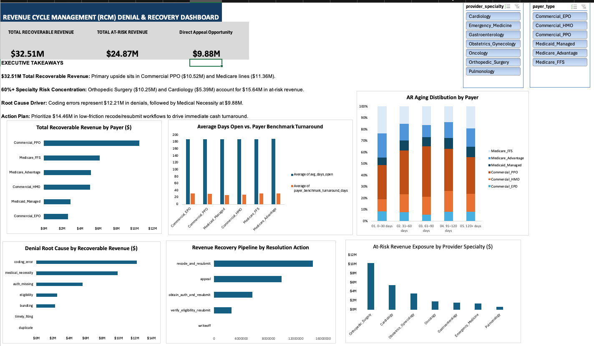

# Healthcare Revenue Cycle Management (RCM): Denial Remediation & AR Recovery Analytics

An executive-level operational analytics framework and interactive BI dashboard analyzing accounts receivable (AR) aging, denial root causes, and net cash acceleration across an active portfolio of 120,000 medical claims.

## 📌 Executive Summary
Across the audited 120k claim portfolio, the analytics engine identified **\$32.51M in Total Recoverable Revenue** against **\$24.87M in immediate at-risk exposure**, supported by a historical **41.50% appeal success rate**. 

* **Primary Financial Upside:** Commercial PPO (\$10.52M) and Medicare lines (\$11.36M combined).
* **Clinical Exposure:** Over 60% of all at-risk dollars are concentrated in Orthopedic Surgery (\$10.25M) and Cardiology (\$5.39M).
* **Operational Bottleneck:** Average claims age exceeds 180 days against a 25–30 day payer processing benchmark, indicating post-submission follow-up backlogs.
* **Immediate Cash Realization:** Prioritizing low-friction `recode_and_resubmit` workflows directly unlocks **\$14.48M** without clinical appeal overhead.

---

## 🛠️ Architecture & Pipeline
1. **Data Engineering (Google BigQuery SQL):**
   - Flattened normalized tables (`claims_main`, `denial_labels`, `payer_rules`) into analytical models.
   - Fixed historical aging bucket distortions using `DATE_DIFF` relative to fixed portfolio anchor dates.
   - Computed cumulative risk exposure using analytical window functions (`SUM() OVER PARTITION`).
2. **Interactive Executive BI (Excel):**
   - 10 structured Pivot Tables driving normalized 100% Stacked Columns, Clustered Horizontal Bars, and payment velocity metrics.
   - Dynamic global multi-slicers (`payer_type`, `provider_specialty`) integrated via unified Report Connections.
   - KPI metric callouts linked directly to summary pivot calculations.

---

## 📊 Core Performance Metrics

| Metric | Portfolio Value | Strategic Significance |
| :--- | :--- | :--- |
| **Total Recoverable Revenue** | **\$32.51M** | Total available cash upside across open and denied pipeline |
| **Total At-Risk Exposure** | **\$24.87M** | Active denied dollars subject to permanent write-off risk |
| **Avg. Appeal Win Rate** | **41.50%** | Expected realization benchmark on clinical disputes |
| **Top Specialty Risk** | **Orthopedic Surgery (\$10.25M)** | Represents 41.2% of organization-wide at-risk revenue |
| **Primary Root Cause** | **Coding Errors (\$12.18M)** | Administrative defects remediable through billing resubmission |

---

## 📁 Repository Contents
* `sql/`: Data ingestion, join logic, aging window calculations, and aggregated KPI queries.
* `dashboard/`: Full interactive Excel workbook with slicer-driven charts and KPI cards.
* `docs/`: Comprehensive Executive Summary memo tailored for hospital operational leadership.
* `assets/`: High-resolution dashboard previews and architectural references.

---

## 🚀 Key Takeaways & Recommendations
1. **Accelerate Immediate Cash (\$14.48M):** Reassign billing specialists to recode and resubmit coding-error denials immediately.
2. **Deploy Clinical Appeals (\$9.88M):** Focus nurse-led appeal bandwidth specifically on Orthopedic Surgery and Cardiology medical necessity rejections.
3. **Automate Front-Door Verification (\$5.63M):** Implement pre-service authorization audits within Patient Access to eliminate missing-auth denials at check-in.
